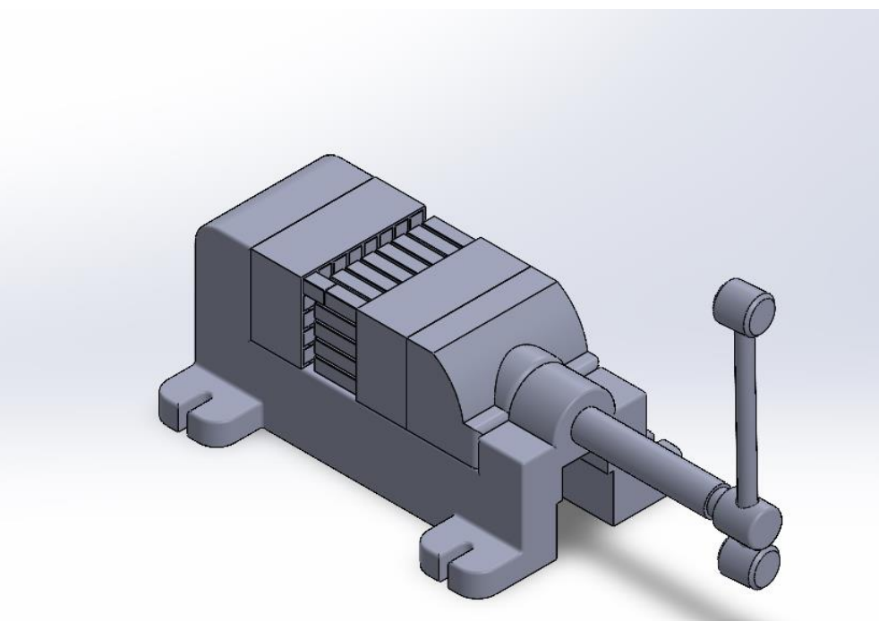
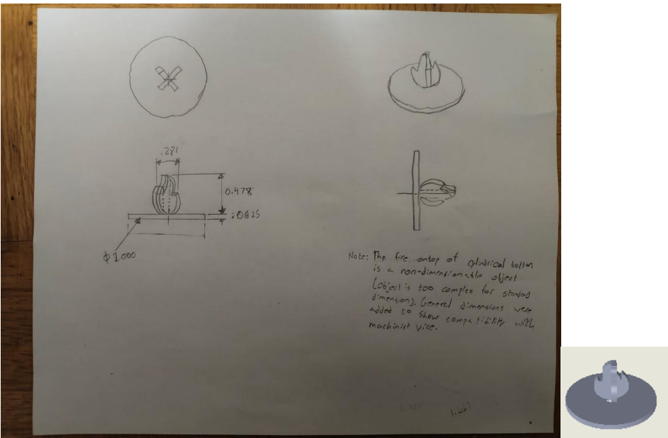
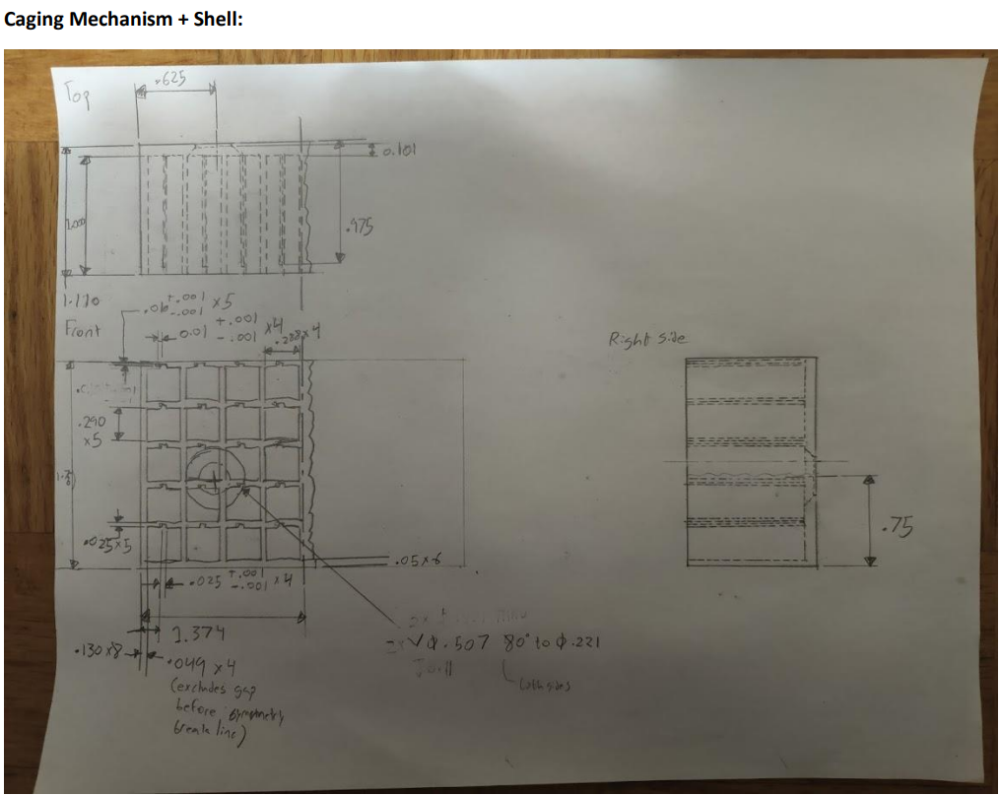
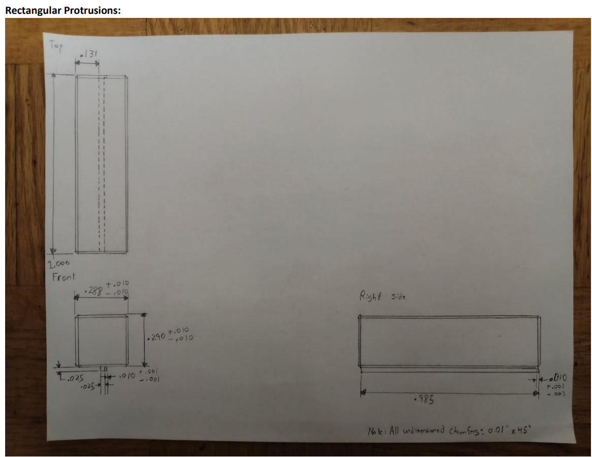

# Adaptive Vice Grip (SolidWorks)

A vice grip insert designed in **SolidWorks** for Lab Mini Design Project 5 at Toronto Metropolitan University. Instead of two flat jaws, it uses a grid of small rectangular protrusions that slide independently, so the grip conforms to irregular objects that a normal vice can't hold securely.

## Design Concept

Three vice grip designs were sketched and compared. The final one (Design 3) is the most complex but also the most adjustable:

- Several rectangular protrusions sit in a **caging mechanism**, and each one can extend or retract individually
- A **viscous fluid or granular material** fills the shell and acts as a cushion during adjustment
- **Chamfered edges** on the protrusions add further cushioning
- The medium must be compressible enough for the protrusions to retract to at least **8/10 of their original length**

## Material and Manufacturing Notes

- The protrusions and the shell should be **metallic** for strength and durability
- The caging system should be made from a **moldable material**, since welding could introduce tolerances high enough to impair the mechanism
- The design is **not deconstructible**: the flat head screw holes are covered by the caging system, so the screws must be installed before the cage is added

## Assembly Sequence

1. Attach the vice grip shell to the base using flat head screws
2. Loosely insert the rectangular protrusions into their slots
3. Add the cushioning material (viscous fluid or granular solid) into the shell
4. Secure everything with the caging mechanism

## Test Object

The object used to check the design is a small flame on a cylindrical base. It is too complex for standard dimensioning, so only general dimensions (about 1.000 in base diameter and 0.478 in height) were added to show compatibility with a machinist vice.

## Key Components

| Component | Notes |
|---|---|
| Caging mechanism + shell | Grid of slots that holds the protrusions, with countersunk holes for flat head screws |
| Rectangular protrusions | About 0.288 in x 0.290 in cross-section, 1.000 in long, with 0.01 in x 45° chamfers |
| Vice base and screw | Standard vice assembly the grip mounts onto |

### Engineering Drawings

All dimensions are in inches.

## Design Limitations and Improvements

A longer vice base would improve the design. In the current layout, the starting position leaves the fully extended protrusions only about halfway apart, so there is little gap to place an object between them.

## Project Structure

- `cad/` → SolidWorks part and assembly files
- `drawings/` → engineering drawings
- `sketches/` → hand sketches of all three vice grip designs
- `images/` → screenshots used in this README
- `docs/` → project write-up

## How to Open

1. Open **SolidWorks**
2. Open the assembly file in `cad/`
3. Keep all part files in the same folder so the assembly can find them

## Tools Used

- SolidWorks (part modeling, assembly, engineering drawings)
- Hand sketching and GD&T-style dimensioning
